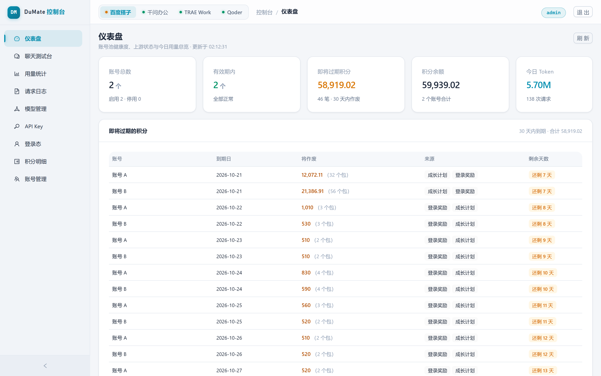
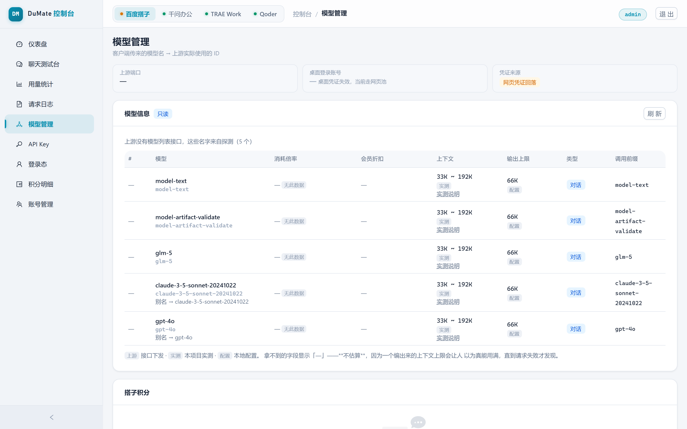
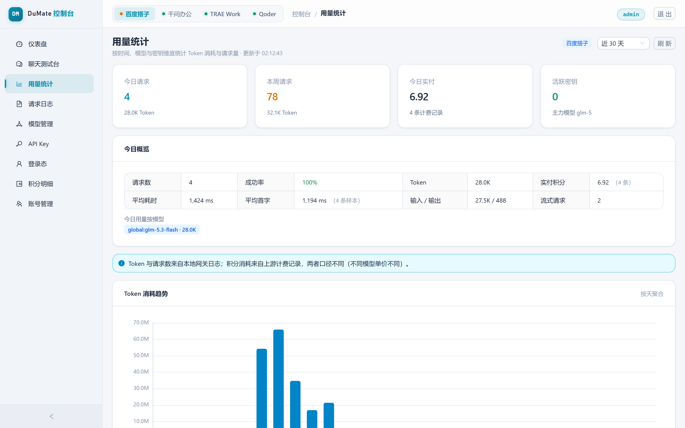
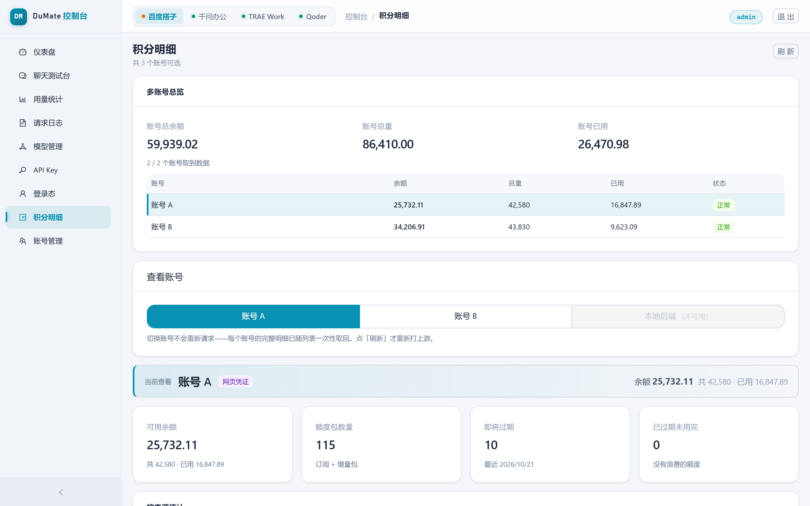
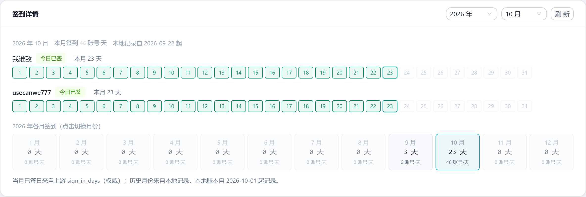
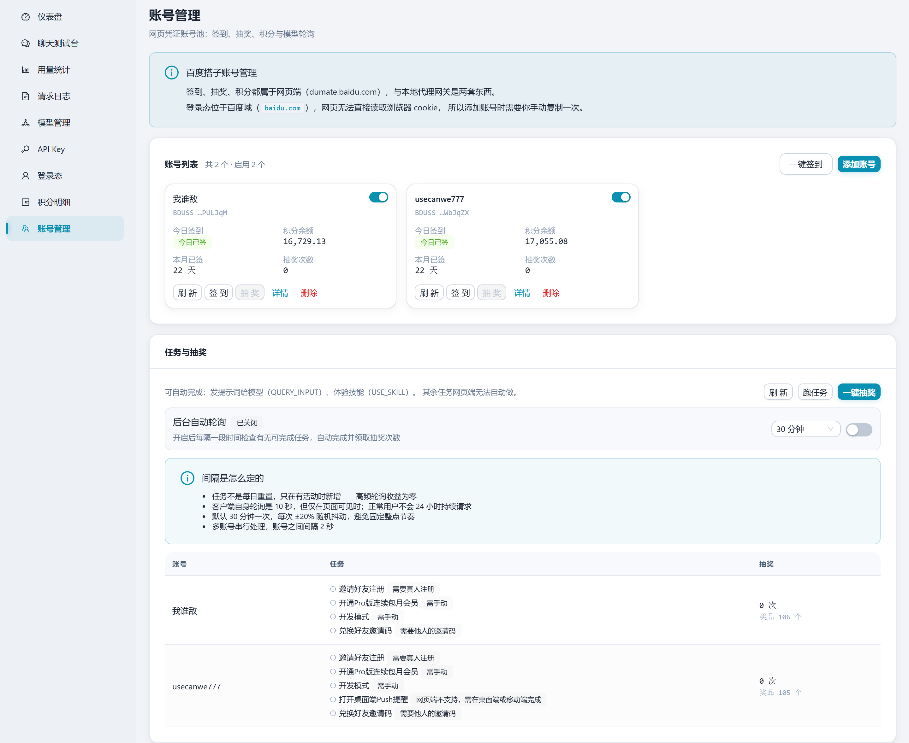

# dumate2api

> 架构与代码详解见 [ARCHITECTURE.md](ARCHITECTURE.md)。


**四条上游 → 三协议网关。** 把百度搭子（DuMate）、千问办公、TRAE Work、Qoder 统一转成 **OpenAI / Anthropic / Google 兼容 API**，供 Codex CLI、Claude Code、cc-switch 等客户端使用；附带网页控制台，管理账号、签到、积分与请求埋点。完整使用说明见 **[用户使用手册](docs/USER_MANUAL.md)**。

<p align="center">
  
</p>

```
Codex CLI ──── OpenAI / Responses ─┐
Claude Code ──── Anthropic ────────┼──→ dumate2api ──┬──→ 百度搭子（网页凭证 / 本地 :8980）
任意客户端 ──── Google ────────────┘                 ├──→ 千问办公（进程内直连）
                                                    ├──→ TRAE Work（进程内直连）
                                                    └──→ Qoder（进程内直连）
```

## 特性

- **三协议 + Responses** —— OpenAI / Anthropic / Google 全覆盖，含 Codex CLI 0.155+ 只认的 `responses` 线格式
- **四通道前缀分流** —— 靠模型名前缀显式路由，未知前缀直接 400，不静默回落
- **零客户端依赖** —— 四条通道凭证均自持；千问与 Qoder 的签名是纯本地算法，不需要官方 wasm 或客户端
- **网关零第三方依赖** —— 只用 Node 内置模块（`playwright-core` 仅管理端浏览器登录器使用）
- **网页控制台** —— 仪表盘、模型管理、积分明细（含按月/按年签到详情）、用量统计、请求日志、聊天测试台
- **签到与积分** —— 签到幂等、可定时；抽奖消耗不可逆，只留手动

## 快速开始

```bash
git clone <repo-url> && cd dumate2api
npm install
npm start                  # 网关 http://127.0.0.1:9080
npm run admin              # 管理端 http://127.0.0.1:9081（另开终端）
```

首次启动管理端会打印随机管理员口令，**只显示一次**。

> 本仓库日常开发用 `start-dev.bat`（网关 9082 + 管理端 9083）；9080/9081 留给 `stable/` 快照对外服务，两者互不影响。

自检：

```bash
curl http://127.0.0.1:9080/health     # 看 channels 里各通道的 ready 状态

curl http://127.0.0.1:9080/v1/chat/completions \
  -H "Content-Type: application/json" \
  -d '{"model":"model-text","messages":[{"role":"user","content":"hello"}]}'
```

**默认凭证来源是网页池**：网关启动时不探测、也不拉起桌面后端。要跑搭子通道，先在管理端「账号管理」登录一个网页账号（或粘贴 cookie）；想用桌面登录态则设 `DUMATE_DUMATE_SOURCE=auto`。千问 / TRAE / Qoder 在「登录态」页走 OAuth，全部无需官方客户端。

## 四条通道

| 通道 | 上游 | 凭证 | 需要官方客户端 |
|---|---|---|---|
| **百度搭子**（DuMate） | 网页接口 / 本地 :8980 | 网页 cookie（默认）/ 桌面登录态 | **否**（`DUMATE_DUMATE_SOURCE=auto` 才用桌面链路） |
| **千问办公**（QwenWork） | 云端网关，进程内直连 | 自持（OAuth Device Flow） | **否**（签名纯本地） |
| **TRAE Work** | 云端网关，进程内直连 | 自持（OAuth） | 否 |
| **Qoder** | 云端网关，进程内直连 | 自持（OAuth Device Flow） | **否**（签名纯本地） |

| 调用方传的模型名 | 路由到 |
|---|---|
| `model-text` / `glm-5` 等（无前缀） | 百度搭子 |
| `qwen/pro` / `qwen/flash` | 千问办公 |
| `traework/glm-5.2` | TRAE Work |
| `qoder/gfmodel` | Qoder |
| 未知前缀（如 `qwn/pro`） | **400 报错，不静默回落** |

> 千问与 Qoder 共用同一套 COSY 协议和一份本地签名实现（`src/cosy.js`）。千问做重创作/长任务用 `pro`（`flash` 会播报进度就收尾）；Qoder 零额度时聊天会挂起，**签到是通道可用的前提**，且倍率差 14 倍、调试用 0.1 档（`gfmodel` 等）。细节与实测数据见 [CLAUDE.md](CLAUDE.md)。

## 客户端配置

| 标签 | API 格式 | Base URL | Key | 模型 |
|---|---|---|---|---|
| Claude | `anthropic` | `http://127.0.0.1:9080` ← 不加 `/v1` | `nokey` | `model-text` |
| Codex | `openai_responses` | `http://127.0.0.1:9080/v1` ← 要加 `/v1` | `nokey` | `model-text` |

Codex 的 `config.toml`：

```toml
model_provider = "dumate"

[model_providers.dumate]
name = "DuMate local proxy"
base_url = "http://127.0.0.1:9080/v1"
wire_api = "responses"          # 0.155+ 只认 responses
requires_openai_auth = true
```

| 端点 | 协议 |
|------|------|
| `POST /v1/chat/completions` | 聊天补全 |
| `POST /v1/responses` 或 `/responses` | Responses（Codex CLI） |
| `POST /v1/messages` 或 `/messages` | Anthropic Messages |
| `GET /v1beta/models` / `POST .../generateContent` | Google Generative Language |
| `GET /v1/models` / `GET /health` | 模型列表 / 健康检查 |

## 管理端

<p align="center">
  
  
  
</p>

<p align="center">
  
</p>

<p align="center"><sub>签到详情：每个账号的当月日历 + 全年各月汇总，切换月份即可回看。搭子 / TRAE / Qoder 共用同一视图，本地账本覆盖起点如实标出。</sub></p>

<p align="center">
  
</p>

<p align="center"><sub>账号管理页：一键签到 / 单账号签到与抽奖 / 跑任务 / 一键抽奖，后台自动轮询的间隔策略如实展示；任务记录并入积分明细的操作流水。</sub></p>

顶栏切换通道，各页面据此显示对应数据。

| 页面 | 回答什么问题 |
|---|---|
| 仪表盘 | 各通道健康、用量、账号状态、即将过期积分 |
| 模型管理 | 有哪些模型、上下文/输出上限、倍率、额度还剩多少 |
| 积分明细 | 积分从哪来、怎么没的；签到详情按月/按年查看 |
| 用量统计 / 请求日志 | 趋势与逐条明细（含每条请求花的积分） |
| API Key / 账号管理 / 聊天测试台 | 签发密钥 / 增删账号跑任务 / 免密钥试调模型 |

> **四条通道的账各自独立，不能相加**：搭子靠上游账单 + 余额游标，千问是三个积分池，TRAE 是每账号独立 credits，Qoder 是订阅 + 赠送两块。

## 常用环境变量

| 变量 | 默认 | 说明 |
|---|---|---|
| `DUMATE2API_PORT` / `_HOST` | `9080` / `127.0.0.1` | 网关监听 |
| `DUMATE_REQUIRE_KEY` | 关闭 | 设 `1` 才校验 API Key。**对外暴露必须打开** |
| `DUMATE_DUMATE_SOURCE` | `web` | 搭子凭证来源。默认 `web` = 只用网页凭证，不需要客户端；`auto`（别名 `desktop`）= 桌面优先、不可用回落网页池 |
| `DUMATE_ADMIN_PORT` / `DUMATE_ADMIN_GATEWAY_PORT` | `9081` / `9080` | 管理端监听 / 管理端读哪个网关；开发实例设为 `9083` / `9082` |
| `DUMATE_QWENWORK_AUTOSTART` / `DUMATE_TRAEWORK_AUTOSTART` | `auto` | 设 `off` 关闭对应通道 |
| `DUMATE_AUTO_CHECKIN_HOUR` / `_MINUTE` | `9` / `17` | 每日自动签到（**两个都要设**） |

> 完整列表见 [CLAUDE.md](CLAUDE.md)。`DUMATE2API_KEY` 是历史遗留死变量，真实开关是 `DUMATE_REQUIRE_KEY`。

## 测试

```bash
npm test                                  # 冒烟测试（需网关在线，默认打 9080）
node test/verify-ccswitch.js              # Codex / Claude / 裸路径 / 模型映射四条链路
node test/verify-checkin-detail.js        # 签到账本与按月/按年查询（离线）
node test/verify-qoder-cosy.js            # 签名算法逐字节比对（离线）
node test/verify-fallback-stream-pipe.js  # 回落路径流式转发（离线）
```

更多离线验证脚本见 `test/verify-*.js`，改完对应模块先跑它们。

## 数据与凭证

| 文件 | 内容 | 敏感度 |
|---|---|---|
| `keys.json` | API Key，**只存 sha256** | 低 |
| `web-accounts.json` | 网页账号，**cookie 明文存** | **高** |
| `*-accounts.json`（qwenwork / traework / qoder） | 直连凭证（含 refresh token） | **高（等同密码）** |
| `admin-users.json` / `admin.secret` | 管理员口令与会话密钥 | **高** |

> `data/` 已在 `.gitignore`。**不要提交，不要放进任何备份镜像**——凭证被复制走是直接可用的。

## 许可证

[MIT](LICENSE)

---

**免责声明**：本项目是独立的第三方开源项目，与百度 / 阿里（千问办公、Qoder）/ 字节（TRAE）及 Anthropic / OpenAI / Google 等主体无隶属、合作或背书关系。它通过协议适配与本地客户端互操作，**不破解、不绕过任何付费墙或授权机制**，**不分发任何上游二进制资产**，也**不上传任何数据**——凭证与日志只存本机。积分自动化可能违反上游服务条款并导致账号受限，后果自负。本项目按「现状」提供，不附带任何担保。
